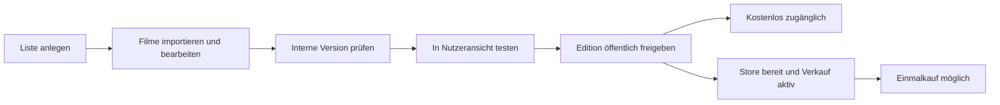

# Konzept: Canon Cockpit

Stand: 06.10.2026. Vorschlag für Produkt und Umsetzung; keine Funktionen,
Migrationen oder Käufe werden durch dieses Dokument aktiviert.

**Empfehlung: Die bestehende separate Admin-Oberfläche zum „Canon Cockpit“
ausbauen.** Hier legen wir Listen an, prüfen sie intern in der echten
Sammlungsansicht, veröffentlichen sie und verwalten ihre Preise zentral.
Web, Android und iOS erhalten diese Konfiguration aus dem gemeinsamen Backend.

## Umgesetzt am 06.10.2026

Name, Beschreibung, Position in der Übersicht, Poster-URL und Titel-im-Poster
sind im Cockpit als Entwurf pflegbar. Die Veröffentlichung übernimmt diese
Darstellung atomar mit der Edition. Reine Darstellungsänderungen erzeugen eine
wiederherstellbare Edition. Web und mobile App erhalten die Konfiguration über
die API. Der **PosterBadge** zeigt angesehen/gesamt, etwa **50/250**; die
Posterfarbe wächst proportional von unten nach oben. Persönlicher Fortschritt
bleibt nutzerbezogen. Die übrigen Vorschläge dieses Dokuments bleiben Planung.

## 1. Ausgangspunkt im Projekt

Schon vorhanden sind ein eigenständiger Go-Admin unter `/canons`, Listenanlage,
JSON-/CSV-Import, Filmbearbeitung, Entwürfe mit Revisionen, Änderungsvorschau,
Editionen mit Wiederherstellung sowie ein Schalter für öffentliche Sichtbarkeit.
Der öffentliche Katalog liefert nur Canons mit `is_live` und gültiger Edition.

Noch fehlen eine interne Vorschau im Stil der Nutzer-App, Preisprofile,
Store-Zuordnungen und Kaufberechtigungen. Cover werden seit Migration 0006
zentral im Cockpit gepflegt. Mobile Konten und Billing sind weiterhin Planung.

Das Cockpit bleibt ein separat gestarteter Dienst und nutzt die bestehende
Datenbank und Importlogik. Für die Verwaltungsseiten reichen zunächst die
vorhandenen Go-HTML-Templates. Gemeinsame React-Komponenten verwenden wir für
die visuelle Vorschau, damit Sammlung, Filter und Album der Nutzeransicht entsprechen.

## 2. Eine neue Liste in sechs Schritten

1. **Anlegen:** Name, vorgeschlagener Slug, Beschreibung, Cover und Quelle
   eingeben. Standard ist „nur intern“; Verkauf ist ausgeschaltet.
2. **Filme hinzufügen:** CSV/JSON hochladen oder Filme über Titel beziehungsweise
   IMDb-ID suchen und auswählen. Auswahl immer mit Jahr/IMDb-ID bestätigen.
   CSV-Vorlage und Spaltenzuordnung vermeiden die Arbeit mit rohem JSON.
3. **Prüfen:** Doppelte IDs, ungültige Reihenfolge, erwarteter Umfang und fehlende
   Zuordnungen werden verständlich angezeigt. TMDb ergänzt vorhandene Filmidentitäten.
   Fehlende Poster erscheinen als Hinweis mit Platzhalter; ungültige Identitäten
   oder unaufgelöste Konflikte blockieren die Freigabe.
4. **Intern testen:** „Vorschau öffnen“ zeigt Cover, Beschreibung, Filmliste,
   Suche, Filter und Album. Desktop- und Mobilansicht sind umschaltbar.
5. **Preis zuweisen:** Kostenlos oder Preisprofil auswählen; bei Einmalkauf die
   Android-/iOS-Produkte zuordnen. Die Konfiguration darf schon vorbereitet werden,
   solange Billing noch nicht verfügbar ist; der Kauf bleibt dann deaktiviert.
6. **Freigeben:** Eine Zusammenfassung zeigt die geprüfte Revision, Filmzahl,
   Änderungen, Sichtbarkeit und Verfügbarkeit je Plattform. „Veröffentlichen“
   übernimmt genau diese Version. „Verkauf aktivieren“ ist eine eigene Aktion.

Listenanlage und Import benötigen für normale redaktionelle Sammlungen keinen
neuen Code und kein App-Update. Ein neuer automatischer Quellenadapter benötigt
weiterhin Backend-Code. Das Cockpit kann einen vorhandenen Adapter auswählen
und konfigurieren, aber keine beliebige Website automatisch zuverlässig auslesen.

Eine erwartete Filmzahl wird pro Canon als feste Zahl oder variabler Umfang
konfiguriert. Die heutigen Sonderregeln für IMDb Top 250 und 1001 Movies werden
schrittweise in diese Konfiguration überführt; neue Listen brauchen keinen
weiteren Slug-Sonderfall im Validator. Eindeutige IDs und Positionen bleiben Pflicht.

Für eigene redaktionelle Listen ist eine externe Quellen-URL optional. Dafür
müssen das aktuelle Pflichtfeld und der Snapshot-Vertrag gemeinsam erweitert
werden; stattdessen erfassen wir Herkunft „Reel Canon Redaktion“.

## 3. Inhalt, Sichtbarkeit und Verkauf getrennt steuern

Ein einzelner Status „Live“ reicht künftig nicht aus:

| Bereich | Zustände | Bedeutung |
| --- | --- | --- |
| Inhalt | Entwurf / intern geprüfte Version / veröffentlichte Edition | Welche Version ist vorbereitet beziehungsweise freigegeben? |
| Sichtbarkeit | Intern / öffentlich / archiviert | Wer kann den Canon entdecken? |
| Zugang | Kostenlos / Einmalkauf | Wodurch erhält man vollständigen Zugriff? |
| Verkauf je Plattform | Vorbereitet / aktiv / pausiert | Können neue Käufe auf Android beziehungsweise iOS stattfinden? |

Eine öffentliche bezahlte Liste kann bereits als Angebotsseite sichtbar sein,
während ihr Verkauf noch vorbereitet wird. Dann lautet die Aktion „Demnächst“.
Eine intern sichtbare Liste ist ausschließlich für das Team verfügbar.

„Verkauf pausieren“ verhindert neue Käufe und erhält den Zugriff der Besitzer.
„Archivieren“ entfernt die Liste aus der öffentlichen Entdeckung und pausiert
den Verkauf; Besitzer behalten die letzte veröffentlichte Edition in ihrer
Bibliothek. Persönlicher Fortschritt bleibt an der Filmidentität gespeichert.
Ein technischer Entzug wegen einer geprüften Erstattung ist ein eigener Vorgang.

Die veröffentlichte Edition und ein neuer Entwurf können gleichzeitig existieren.
Bei einer späteren Aktualisierung testen wir die neue Version intern; Nutzer
sehen bis zur Freigabe weiterhin die bisherige Version.

## 4. Vorschau zunächst nur für uns

### Erste Version ohne Nutzerkonten

Das Cockpit bietet eine **geschützte Vorschau auf seiner eigenen Origin**.
Sie nutzt dieselben React-Ansichten wie die öffentliche App, lädt ihre Daten
aber ausschließlich über Admin-Vorschau-Endpunkte. Die vorhandene
Admin-Anmeldung schützt Seite, Daten und interne Cover gleichermaßen.
Admin-Zugangsdaten werden niemals in die öffentliche App eingebaut.

„Vorschau öffnen“ erzeugt einen unveränderlichen internen Stand aus dem Entwurf:
Filme, Texte, Cover und Darstellung werden an dessen Revision gebunden.
Weitere Bearbeitung verändert diesen geprüften Stand nicht. Für eine Freigabe
muss die aktuelle Entwurfsrevision dem geprüften Stand entsprechen; sonst ist
eine neue Prüfung nötig. Gemeinsame Filmmetadaten können später aktualisiert
werden; ihre angezeigte Fassung wird für den Prüfstand ebenfalls eingefroren.

Die Vorschau zeigt dauerhaft „Interne Vorschau · Revision …“ und erlaubt die
Ansichten „kostenlos“, „noch nicht gekauft“ und „bereits freigeschaltet“.
Testhäkchen werden in einem eigenen Vorschau-Speicher abgelegt und können
zurückgesetzt werden. Sie verändern keinen echten Nutzerfortschritt.
Kaufbuttons simulieren Zustände oder verwenden später Store-Sandbox-Käufe;
die Vorschau löst keine echten Zahlungen aus.

Interne Daten bekommen `Cache-Control: no-store`. Ein Vorschau-Link ist nur eine
Navigation, keine Zugangsberechtigung. Die öffentliche API, Filmmitgliedschaften,
Suchergebnisse und öffentliche Cover-Auslieferung geben interne Listen nicht preis.
Für die neuen Vorschaupfade muss auch der heutige CSRF-Cookie-Pfad angepasst werden,
falls dort schreibende Aktionen hinzukommen.

### Später mit Konten: Vorschau direkt in Web und App

Nach Einführung der Konten ergänzen wir eine serverseitig gepflegte Teamrolle
oder explizite Tester-Freigaben pro Canon. Diese Nutzer können „Vorschau-Canons“
in der normalen App öffnen. Eine Anmeldung allein genügt dafür nicht.
Der Server prüft diese Berechtigung bei jedem internen Datenabruf.

Testerzugang bleibt von einem Kauf getrennt: Er ist widerrufbar, erzeugt keinen
Kaufbeleg und wird bei Veröffentlichung nicht automatisch zum dauerhaften Besitz.
Zeitlich begrenzte Freigaben sind später möglich. Native Kaufprüfung wird getrennt
mit Sandbox beziehungsweise Testkanälen getestet.

## 5. Zentrale Preisverwaltung

### Preisprofile als gemeinsame Vorgabe

Wir führen zentral gepflegte Preisprofile ein. Für den Start genügen:

| Profil | Vorgabe | Verwendung |
| --- | --- | --- |
| Kostenlos | Kein Kauf nötig | Empfohlener Einstieg: IMDb Top 250 |
| Standard | EUR-Basispreis 0,99 € einmalig | Neue bezahlte Listen laut Mobile-Plan |

Ein Canon verweist auf ein Profil. Weitere Preisstufen oder eine begründete
Einzelausnahme sind später möglich. Beträge werden als Ganzzahl in kleinster
Währungseinheit gespeichert, z. B. `99` mit `EUR`; keine Fließkommazahlen.
Eine neue Edition desselben Canons ist im bestehenden Einmalkauf enthalten.

Ein Profilwechsel verändert zunächst einen **Preis-Entwurf**. Das Cockpit zeigt
die betroffenen Listen, alten und neuen Wunschpreis sowie Store-Abweichungen.
Eine ausdrücklich ausgeführte Anwendung erzeugt eine neue Preisrevision mit
Zeitpunkt und Bearbeiter. Schon abgeschlossene Käufe bleiben unverändert.

### Unser Wunschpreis und der Store-Preis

Das Cockpit verwaltet zentral die Produktentscheidung und den gewünschten
Basispreis. Der wirksame lokale Kaufpreis wird weiterhin durch den jeweiligen
Store geliefert. Apple unterstützt Basisregion, regionale Preise und geplante
Preisänderungen; Google bietet eine API zur Produktkatalogverwaltung.
[Apple-Preisverwaltung](https://developer.apple.com/help/app-store-connect/manage-in-app-purchases/set-a-price-for-an-in-app-purchase/),
[Google-Produktkatalog](https://developer.android.com/google/play/billing/manage-catalog).

Deshalb zeigt die Preisübersicht je Canon:

- Preisprofil und gewünschter EUR-Basispreis;
- stabile interne Produkt-ID und Store-Produkt-IDs;
- Region, zuletzt abgeglichener Store-Preis und Prüfzeitpunkt;
- Verfügbarkeit und Preisabgleich getrennt für Android und iOS;
- Abweichungen sowie ausstehende Änderungen.

In der App wird der aktuelle formatierte Preis aus Play Billing beziehungsweise
StoreKit angezeigt. Ein gespeicherter EUR-Wunschpreis ersetzt dieses Ergebnis
nicht. Fehlt ein gültiges Store-Angebot, ist der Kauf deaktiviert.
[Google-Produktdetails](https://developer.android.com/google/play/billing/integrate),
[Apple In-App Purchase](https://developer.apple.com/in-app-purchase/).

### Zwei Ausbaustufen

**Start:** Preisprofile und Store-IDs werden im Cockpit gepflegt. Store-Produkte
und Preise richten wir in den Store-Konsolen ein; das Cockpit dokumentiert den
Abgleich, anfangs als manuell bestätigt mit Zeitstempel. Es behauptet keine
automatische Prüfung oder Synchronisierung, solange diese nicht implementiert ist.

**Später:** Backend-Adapter lesen und schreiben Preise über die Store-APIs.
Apple stellt dafür Preispläne bereit; Google unterstützt Produktaktualisierungen.
[Apple-Preispläne](https://developer.apple.com/documentation/appstoreconnectapi/in-app-purchase-price-schedules),
[Google-Einmalprodukte](https://developers.google.com/android-publisher/api-ref/rest/v3/monetization.onetimeproducts).

Diese Synchronisierung läuft als dauerhafter Auftrag mit Wiederholungen und
Rücklesen. Wunsch und bestätigter Zustand bleiben getrennt. Wenn eine Plattform
scheitert, zeigt das Cockpit das Teilergebnis statt „überall erfolgreich“.
Erfolgreiche API-Annahme ersetzt keine Store-Freigabe oder tatsächliche Verfügbarkeit.
Store-Secrets bleiben im Backend. Bei wenigen Listen reicht der manuelle Start.

Im ersten Kaufumfang gibt es entsprechend dem Mobile-Plan keinen Web-Checkout.
Das Web nutzt dieselben bestätigten Konto-Freischaltungen zum Lesen.

## 6. Die Oberfläche des Canon Cockpits

| Seite | Inhalt und Hauptaktionen |
| --- | --- |
| Übersicht | Alle Listen; Filter für intern, öffentlich, archiviert; Filmzahl, Edition, Datenfehler und Verkauf je Plattform; „Neue Liste“ |
| Canon: Inhalt | Texte, Cover, Herkunft, Filme suchen/importieren/sortieren, Umfang prüfen |
| Canon: Vorschau | Geprüfte Revision, Desktop/Mobil, Sammlung/Album, Kaufzustände simulieren |
| Canon: Veröffentlichung | Vergleich zur bisherigen Edition, Freigabe, Wiederherstellung, Sichtbarkeit |
| Canon: Preis & Verkauf | Profil, Store-Produkte, Abgleichstatus; Verkauf je Plattform aktivieren/pausieren |
| Preise | Profile bearbeiten, betroffene Listen vergleichen, Preisänderungen anwenden |
| Verlauf | Wer änderte Inhalt, Sichtbarkeit, Testerzugang, Preis oder Verkauf; vorher/nachher und Ergebnis |

Der Einstieg bleibt `/canons`; „Canon Cockpit“ ersetzt die heutige Admin-Bezeichnung.
Das Cockpit zeigt konkrete nächste Schritte wie „Cover fehlt“, „Import prüfen“
oder „iOS-Produkt noch nicht verfügbar“. Aktionen und deren Wirkung bleiben
verständlich, technische Einzelheiten stehen bei Bedarf in Details.

## 7. Technischer Zuschnitt

Wir erweitern die vorhandenen Tabellen und Dienste. Keine zweite Katalogdatenbank.
Die folgenden Ergänzungen sind ein Schema-Vorschlag, keine aktiven Migrationen:

| Daten | Vorschlag |
| --- | --- |
| canons | Sichtbarkeit, variable/feste Umfangsregel; stabile Canon-ID beibehalten |
| canon_drafts / canon_editions | Texte und Cover als versionierter Veröffentlichungsstand neben der Mitgliedschaft |
| canon_assets | Cover, Version, Darstellung mit/ohne eingebetteten Titel und Zugriffsstatus |
| canon_preview_releases | Unveränderlicher interner Prüfstand mit Entwurfsrevision und erfassten Metadaten |
| price_profiles / price_revisions | Zentraler Basispreis, Versionen und Anwendung auf Produkte |
| canon_products | Zugang kostenlos/Einmalkauf; Profil und angewendete Preisrevision |
| store_products | Plattform, stabile Store-ID, Umgebung, Region/Preisstand und Verkaufsstatus |
| canon_preview_grants | Später explizite Testerzuordnung zu Konten, optionales Ablaufdatum |
| admin_audit_events | Individueller Bearbeiter, Aktion, Ressource, Änderungen und Ergebnis |

`canon_products` und `store_products` sind die bereits im Mobile-Plan vorgesehenen
Tabellen, hier präzisiert. Kaufnachweise und `user_canon_entitlements` bleiben
Teil desselben geplanten Billing-Moduls; keine parallele Freischaltungstabelle.

Die bisherigen Entwürfe enthalten schon Name und Beschreibung. Ihre Übernahme
in die veröffentlichten Canon-Felder und die neue Cover-Version müssen künftig
gemeinsam mit der Edition erfolgen. Redaktionelle Felder werden von importierten
Quellentexten getrennt, damit ein Refresh das gestaltete Angebot nicht überschreibt.

`is_live` wird kontrolliert auf die neue Sichtbarkeit abgebildet: bisher live
entspricht öffentlich, bisher verborgen entspricht intern. Bestehende Canons
bleiben zunächst kostenlos. Öffentliche Lesezugriffe behalten ihre separate
Datenbankrolle; Konto-/Kaufschreibvorgänge erhalten später gezielt eigene Rechte.

Die heutige Canon-Übersicht liefert bereits sämtliche `imdbIds`. Vor Einführung
bezahlter Canons müssen **alle** Katalogwege serverseitig Zugriff prüfen:
Übersicht, Detail, Filmmitgliedschaften und spätere Suche/Downloads. Öffentliche
Angebote enthalten nur Beschreibung, Umfang, Cover und ausgewählte Beispielfilme.
Die vollständige Mitgliedschaft erhalten nur Berechtigte. Die bisherige
Fortschrittsberechnung der Karten wird dafür angepasst; gesperrte Karten zeigen
keinen aus versteckten IDs berechneten Fortschritt. Gemeinsame Filmdaten bleiben
filmbezogen, interne Listenzugehörigkeiten bleiben verborgen.

Für Einzelbetrieb genügt anfangs die bestehende geschützte Admin-Anmeldung.
Sobald mehrere Personen bearbeiten oder Tester verwaltet werden, braucht das
Cockpit individuelle Zugänge: Redaktion für Inhalt/Prüfung, Administration für
Veröffentlichung, Preise und Zugang. Änderungen werden mit diesen Identitäten
protokolliert. Ein gemeinsamer Basic-Auth-Zugang erlaubt keine individuelle Zuordnung.

## 8. Reihenfolge und Abnahme

| Schritt | Ergebnis | Abnahme |
| --- | --- | --- |
| 1. Listenpflege | Name Canon Cockpit, geführte Anlage, CSV-Vorlage, Filmwahl, Cover und Umfangsregeln | Eine neue redaktionelle Liste lässt sich ohne Codeänderung vollständig vorbereiten |
| 2. Interne Vorschau | Geschützter Prüfstand mit echten React-Sammlungsansichten | Team sieht intern Cover/Filme/Album; öffentliche API und Direktlinks liefern keine internen Inhalte |
| 3. Veröffentlichung | Revision gebunden freigeben, Sichtbarkeit getrennt steuern | Genau der geprüfte Stand wird live; spätere Entwürfe verändern die Nutzeransicht nicht |
| 4. Preisverwaltung | Standardprofil 0,99 €, Preisrevisionen, Store-IDs und Abgleichübersicht | Preisänderung nennt alle betroffenen Listen; vorbereitete Preise aktivieren keinen Kauf |
| 5. Konten und Billing | Teamvorschau in Apps, Kaufprüfung, Wiederherstellung, Zugriffsregeln | Nichtberechtigte erhalten keine vollständige bezahlte Liste; bestätigter Kauf gilt im selben Konto auf allen Clients |
| 6. Store-Abgleich | Bei Bedarf automatische Preisaufträge | Teilerfolge, Fehler und verzögerte Wirksamkeit bleiben sichtbar und wiederholbar |

Bei der Umsetzung gehören gezielte API-/Integrationstests für Zugriff und
Revisionskonflikte sowie ein Browserfluss „anlegen → intern prüfen → veröffentlichen“
dazu. Billing ergänzt Sandbox-Prüfungen für ausstehende Käufe, Wiederherstellung,
Erstattung und Verkaufspause. Archivieren oder Verkaufspause entfernt weder
gültige Besitzerrechte noch persönlichen Fortschritt.

Der erste konkrete Ausbau umfasst Schritte 1–3 und die Vorbereitung von Schritt 4.
So können wir zusätzliche Listen schon intern pflegen und testen, während
[Konten](accounts-and-progress-concept.md) und
[mobile Käufe](mobile-app-implementation-plan.md) anschließend hinzukommen.
