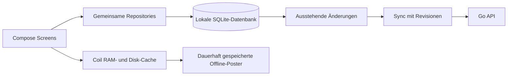

# Umsetzungsplan: Reel Canon für Android und iOS

> **Finanzierung, 06.10.2026:** Reel Canon bleibt ein ambitioniertes Hobbyprojekt.
> Serverkostendeckung und später etwa 200 € monatlich sind die Orientierung.
> Die folgenden 0,99-€-Listenpreise sind eine mögliche frühere Variante;
> Unterstützungsbeiträge, Werbung/Werbefrei-Kauf und Streaming-Pro bleiben ebenfalls
> offen. Siehe [Hobbyfinanzierung](hobby-financing-concept.md). Kein Kaufmodell wird
> durch diese Planung aktiviert.

Der [Unterstützungsplan für Web und Apps](support-implementation-plan.md)
empfiehlt Ko-fi Free auf der Website und spätere native Trinkgeldkäufe über
Play Billing/StoreKit. Ein externer Ko-fi-Link in den Store-Apps bleibt von der
konkreten Richtlinienprüfung abhängig; reine Unterstützung schaltet nichts frei.

Stand: 2026-10-07. **Android-Grundlage, Google-Credential-Manager-Flow, sichere
mobile Sessions und konto-getrennter Fortschrittsabgleich sind unter `mobile/`
implementiert und auf einem Emulator geprüft.** Die Backend- und Room-Verträge
liegen in `contracts/mobile-api.md`. Ein echter Android-OAuth-Client in Google
Cloud ist noch nicht verifiziert, deshalb ist der produktive Google-Login noch
nicht konfigurationsseitig abgenommen. iOS ist vorbereitet, aber auf Windows weder
gebaut noch geprüft; sein nativer Login-Adapter fehlt. Käufe/Billing, WorkManager
und Store-Veröffentlichung bleiben Zielbild. Siehe
[Implementierung und Start](../mobile/README.md).

## Ziel und Produktumfang

Eine gemeinsame Kotlin-Codebasis für Android und iOS mit **Kotlin Multiplatform
und Compose Multiplatform**. Gemeinsame Oberfläche, Domänenlogik, lokale Datenbank,
API-Client und Synchronisierung; kleine Plattformadapter für Betriebssystemfunktionen.
Die bestehende React-Web-App bleibt ein eigener Client desselben Go-Backends.

Die App bietet Sammlungen, Suche/Filter, Filmdetails, Jahrzehnt-Album, Gesehen-
Status und Watchlist. Geladene Sammlungen sind offline nutzbar. Häkchen können
offline gesetzt und entfernt werden. Neue Listen werden für **einmalig 0,99 €
pro Liste** gekauft. Vorgeschlagener kostenloser Einstieg: bisherige IMDb Top 250.
Der Preis gilt als gewünschter EUR-Basispreis, nicht als fest eingeblendeter Preis
in jeder Region. Ein Kauf umfasst den Canon samt späteren Editionen, kein Abo.

Aktueller Stand: Go/PostgreSQL-Katalog, React-MVP, Web-Konten und Browser-Fortschritt
sind vorhanden; Android teilt dieselben Konten und synchronisiert Fortschritt mit
Revisionen. 1001 Movies und ein Kauf-Backend sind noch nicht vorhanden.

## Technische Entscheidung

| Bereich | Planung |
| --- | --- |
| Geteilte Logik | Kotlin Multiplatform, Coroutines, Flow, kotlinx.serialization |
| Geteilte Oberfläche | Compose Multiplatform, gemeinsame Screens/ViewModels/Navigation |
| Lokaler Speicher | Room für KMP mit SQLite, Schema-Migrationen und Transaktionen |
| Netzwerk | Ktor mit passendem Android-/iOS-Engine; bestehende REST-API |
| Bilder | Coil 3 mit Ktor, RAM- und Disk-Cache; eigener dauerhafter Download-Speicher |
| Geheimnisse | Plattformadapter: Android Keystore / iOS Keychain |
| Login | E-Mail/Passwort und Google zuerst; Apple vor entsprechendem iOS-Release ergänzen |
| Kauf | Android Play Billing; iOS StoreKit 2; gemeinsames Billing-Interface |
| Hintergrundabgleich | Android WorkManager; iOS geeignete Background Tasks plus Abgleich im Vordergrund |

Android und iOS sind für Compose Multiplatform als stabil ausgewiesen.
Compose teilt auch UI-Code; Betriebssystemintegration bleibt plattformspezifisch.
Es entstehen native App-Pakete. Auf iOS wird Compose-UI nicht automatisch aus
UIKit-Standardcontrols zusammengesetzt; UIKit/SwiftUI-Integration ist bei Bedarf
über Adapter möglich. Performance und Bediengefühl werden auf echten Geräten
geprüft, nicht allein aus dem Framework abgeleitet.
[Plattformstatus](https://kotlinlang.org/docs/multiplatform/supported-platforms.html),
[Compose](https://kotlinlang.org/docs/multiplatform/compose-multiplatform-and-jetpack-compose.html).

**Eine mobile Codebasis bedeutet:** dieselben Features und Screens für beide
Plattformen, aber zwei signierte Builds und kleine native Einstiegspunkte.
React-Komponenten lassen sich nicht direkt als Compose-Screens übernehmen.
Design, API-Vertrag und Datenmodell werden wiederverwendet; die mobile UI wird
gemeinsam in Kotlin aufgebaut. Ein kompletter Web-Frontend-Wechsel ist nicht vorgesehen.

## Geplante Monorepo-Struktur

```text
mobile/
  composeApp/
    src/commonMain/       Screens, ViewModels, Domain, Repository, Room, Ktor, Sync
    src/androidMain/      Android-Adapter: Login, Billing, Keystore, Hintergrundjobs
    src/iosMain/          iOS-Adapter: Plattformzugriff, Keychain, Hintergrundjobs
  androidApp/             Android-Einstieg, Manifest, Signing und Store-Konfiguration
  iosApp/                 Xcode-Einstieg und gegebenenfalls kleine Swift-SDK-Brücken
  gradle/libs.versions.toml
backend/internal/auth/    Gemeinsame Konten für Web und Apps
backend/internal/billing/ Kaufprüfung und Berechtigungen, später
contracts/               Gemeinsame API-/Sync-/Kaufverträge
```

Diese Verzeichnisse sind für die App-Grundlage angelegt. Zu Beginn reichen ein geteiltes
Modul und zwei Einstiegspunkte; weitere Feature-Module erst bei tatsächlichem
Bedarf. Versionen zentral festlegen und als kompatibles Set auf beiden Plattformen
prüfen. Keine pauschale Behauptung, dass StoreKit/Login ohne native Brücke auskommen.

## Offline-Verfügbarkeit und Bildspeicher



### Lokale Daten

- Canon, Edition/Mitgliedschaft und Filmmetadaten lokal speichern. Der Server
  bleibt die Quelle für veröffentlichte Editionen; UI liest aus der lokalen DB.
- Fortschritt je Konto und IMDb-ID speichern, unabhängig von Canon/Edition.
  Gastdaten und Accountdaten strikt trennen. Eigener Fortschritt bleibt beim
  Entfernen einer Sammlung oder beim Löschen des Bildcaches erhalten.
- Abhaken/Entfernen schreibt lokal sofort in einer Transaktion **Zustand und Outbox**.
  Neue Installation ohne vorherige Daten benötigt zunächst Netz oder importierte
  Daten; Offline-Verfügbarkeit gilt für bereits geladene Inhalte.
- Sammlungen aktualisieren, indem eine vollständige neue Edition atomar ersetzt
  wird. Ein unvollständiger Download darf die letzte lesbare Edition nicht zerstören.

Lokale Tabellen, Vorschlag: cached_canons, cached_editions, cached_movies,
cached_canon_movies, local_progress, sync_outbox, cached_entitlements, downloaded_images.
[Room für KMP](https://developer.android.com/kotlin/multiplatform/room),
[Offline-Architektur](https://developer.android.com/topic/architecture/data-layer/offline-first).

### Bilder

Coil übernimmt Decode, Größenanpassung und RAM-/Disk-Cache. Ein gemeinsamer
ImageLoader und stabile Schlüssel aus Posterpfad/Größe verhindern Mehrfachdownloads.
Vorschaubilder passend zur Bildschirmgröße laden, nicht volle Originalposter.

**Vorschlag für den Start:** begrenzter automatischer Disk-Cache von 150 MiB,
RAM-Budget nach Gerät, Prefetch nur nahe sichtbarer Kacheln. Grenzen später messen.
Der Cache darf Einträge verdrängen und das Betriebssystem kann Cachedateien entfernen.

Für die Funktion „Sammlung offline speichern“ daher zusätzlich Metadaten und
Poster in einen dauerhaften App-Dateispeicher herunterladen, außerhalb des
flüchtigen LRU-/OS-Caches. Downloadfortschritt, Speicherbedarf, WLAN-Option und
Entfernen einzelner Sammlungen anbieten. Gemeinsame Poster nur einmal speichern,
Referenzen zählen; Entfernen einer Sammlung löscht keine von anderen benötigten Bilder.
Downloads von Geräte-Backups ausschließen, da erneut abrufbar.
Fehlende Bilder bekommen einen lokalen Platzhalter; keine Offline-Spinner.
[Coil/Ktor](https://coil-kt.github.io/coil/getting_started/),
[Coil-Caches](https://coil-kt.github.io/coil/image_loaders/).

### Synchronisierung

Jeder Outbox-Eintrag enthält Konto-ID, IMDb-ID, geändertes Feld/Zielwert, bekannte
Serverrevision und eine eindeutige Operations-ID. Kein Toggle und kein blindes
Überschreiben nach Geräteuhr. Ausstehende Änderungen je Film/Feld können verdichtet
werden; Updates erhalten das jeweils andere Feld.

1. Nach Start, Vordergrundwechsel oder Netzrückkehr gültige Anmeldung sicherstellen.
2. Aktuellen vollständigen Fortschritt einschließlich entfernter Zustände laden.
   Zunächst Vollabgleich für die kleinen Sammlungen; Delta-Cursor erst mit sicherer
   serverseitiger Ordnung, keine naiven Zeitstempel-Cursor.
3. Ausstehende Änderungen atomar mit erwarteter Revision senden.
4. Operations-ID serverseitig wiederholbar verarbeiten; verlorene Antworten und
   wiederholte Zustellung erzeugen keine zweiten Änderungen.
5. Bei gleicher Zielwirkung bereits erledigt; bei widersprüchlicher neuerer Revision
   Konflikt sichtbar machen und Nutzerentscheidung anbieten. Nicht still überschreiben.
6. Bestätigte Antwort und Outbox-Abschluss lokal gemeinsam speichern.

Erforderliche Backend-Erweiterung zum Kontenschema: dauerhafte Idempotenz für
mobile Operationen, z. B. progress_operations mit UNIQUE(user_id, operation_id).
Request-Inhalt und gespeichertes Ergebnis binden; gleiche ID mit anderem Inhalt
ablehnen. Aufbewahrungs-/Retry-Fenster vor Umsetzung definieren.
Hintergrundausführung auf iOS ist nicht garantiert; Vordergrundabgleich ist immer
vorgesehen. Bei abgelaufenem Login bleiben lokale Häkchen samt Outbox erhalten;
nach Abmeldung werden Accountdaten entfernt oder nach ausdrücklicher Auswahl gesichert.

## Konto und mobile Anmeldung

E-Mail/Passwort greift auf die gleiche Account-API wie die Web-App zu.
Android-Google-Login über Credential Manager, iOS über den passenden Google-
SDK-/Systembrowser-Adapter. Backend validiert Token/Nonce und eine feste Allowlist
der Web-, Android- und iOS-Client-IDs. OAuth-Secrets gehören niemals ins App-Paket.
[Credential Manager](https://developer.android.com/identity/credential-manager),
[Native OAuth](https://developers.google.com/identity/protocols/oauth2/native-app).

Web-Cookies werden nicht unverändert zum mobilen Auth-Vertrag erklärt.
Geplant sind eigene kurzlebige App-Zugangstokens mit widerrufbarem, rotierendem
Erneuerungsmechanismus und sicherer Plattformablage. Wiederverwendung alter
Refresh-Tokens erkennen; Konto-Sperre, Reset und Logout widerrufen die App-Sessions.
Provider-Tokens werden nicht als Reel-Canon-API-Zugänge verwendet.
Serverseitige Konto-ID bleibt über Plattformen identisch; Accounts nicht per
E-Mail oder bloßer Google-/Apple-Namensgleichheit zusammenführen.

Vor iOS-Store-Release mit Google-Login ist Apples Regel 4.8 zu berücksichtigen:
Sie verlangt, sofern keine Ausnahme zutrifft, eine gleichwertige datensparsame
Login-Option mit Möglichkeit, die E-Mail-Adresse privat zu halten. Dafür wird
**Sign in with Apple** eingeplant; E-Mail/Passwort allein erfüllt nicht automatisch
diese Anforderung. Android kann vorher mit Google/E-Mail erscheinen.
[App Review: Login](https://developer.apple.com/app-store/review/guidelines/#login-services).

## Listen für 0,99 € kaufen

### Produktmodell

- Pro Canon ein dauerhafter Einmalkauf: Android nicht konsumieren,
  iOS als Non-Consumable. Keine Credits, die später beliebige Listen kaufen.
- IMDb Top 250 bleibt nach vorgeschlagener Basis kostenlos. Weitere vollständig
  vorbereitete Canons erhalten eine eigene Produktzuordnung.
- Kauf umfasst alle späteren Editionen desselben Canons. Für dieselbe Liste auf
  einem zweiten Gerät nicht erneut bezahlen.
- Vor Kauf im Reel-Canon-Konto anmelden, damit Kauf und Gerätezugriff verlässlich
  zugeordnet werden. Bereits vorhandene Berechtigung verhindert erneuten Kauf.
- Gleiche Konto-Freischaltung gilt auf Android, iOS und beim Lesen im Web;
  erste Version implementiert keinen zusätzlichen Web-Checkout.
- Preis und Währung aus dem jeweiligen Store laden. 0,99 € als Basispreis
  konfigurieren; andere Länder, Steuern und Store-Preisregeln können abweichen.
  Der Endpreis stammt aus Play Billing/StoreKit, nicht aus einem fest codierten Label.

Plattformadapter: Play Billing auf Android, StoreKit 2 auf iOS. Gemeinsames
Interface für Produkte laden, kaufen, wiederherstellen und Kaufereignisse beobachten.
Dadurch bleiben Kauf-Screens und Berechtigungslogik in commonMain.
[Google Billing](https://developer.android.com/google/play/billing/integrate),
[Apple IAP](https://developer.apple.com/in-app-purchase/),
[Apple-Preisverwaltung](https://developer.apple.com/help/app-store-connect/manage-in-app-purchases/set-a-price-for-an-in-app-purchase/).

### Kaufprüfung und Wiederherstellung

1. App lädt Canon-Angebote und zugehörige Store-Produkte samt lokalem Preis.
2. Server erzeugt einen Kaufkontext für das angemeldete Konto/Produkt.
   appAccountToken bei Apple beziehungsweise obfuscatedAccountId bei Google zur
   Zuordnung verwenden; keine E-Mail an den Store als interne Konto-ID.
3. Store führt den Kauf aus. Abgebrochen oder ausstehend bedeutet noch keine Freischaltung.
4. App übermittelt Store-Nachweis an das Backend. Dieses prüft ihn bei Google
   beziehungsweise mit Apples signierten Transaktionen/Server-API: Produkt,
   App-ID, Umgebung, Zustand, Zuordnung und Widerruf.
5. Kauf und Canon-Berechtigung in einer Transaktion persistieren. Nachweise sind
   eindeutig; derselbe Kauf darf nicht mehreren Reel-Canon-Konten zugeordnet werden.
6. Verarbeitung wiederholbar abschließen: Android-Kauf zuverlässig rechtzeitig
   acknowledge, ohne ihn zu konsumieren; iOS-Transaktion nach erfolgreicher
   Verarbeitung finish. Bei Ausfällen Queue/Retry statt verlorener Freischaltung.
7. App lädt den bestätigten Zugriff und kann die Liste offline speichern.

Google nennt drei Tage für die Bestätigung eines verarbeiteten Kaufs; daher
serverseitiges Retry/Monitoring dafür einplanen.
[Bestätigung](https://developer.android.com/google/play/billing/integrate#acknowledge).

„Käufe wiederherstellen“ ist im Konto sichtbar. Nach Neuinstallation Store-Käufe
erneut abrufen und beim Backend prüfen. Ein schon einem anderen Reel-Canon-Konto
zugeordneter Kauf führt in einen geprüften Wiederherstellungs-/Supportfluss,
nicht zur automatischen Übertragung. Kontolöschung und spätere Wiederherstellung
dürfen keine fremden Käufe übernehmen; dafür vor Billing-Freigabe die konkrete
Kontozuordnungs-/Aufbewahrungsregel festlegen. Family Sharing zunächst deaktiviert.

### Serverberechtigungen und Datenmodell

| Geplante Tabelle | Kerndaten / Integrität |
| --- | --- |
| canon_products | Canon-ID, Status, kostenlos/kaufbar; stabile Produktdefinition |
| store_products | Produkt-ID, Plattform, Store-SKU, Umgebung/Verfügbarkeit; eindeutige SKU je Plattform/Umgebung |
| store_purchases | Nutzer, Produkt, Store, eindeutiger Transaktions-/Token-Schlüssel je Umgebung, Kaufzustand, Prüfzeit; sensible Nachweise verschlüsselt |
| user_canon_entitlements | Nutzer/Canon als eindeutiger Schlüssel, aktiver Zugriff und Revision; aus gültigen Käufen ableiten |
| billing_events | Eindeutige Store-Ereignis-ID, minimaler geprüfter Inhalt, Verarbeitungsstatus |
| billing_jobs | Dauerhafte Prüfung/Bestätigung/Retry, Lease und Fehlerzustand |

Diese Tabellen sind Planung und noch kein ausgeführtes SQL. Entitlements sind
eine serverseitige Berechtigung, kein vom Client geliefertes purchased=true.
Wenn ein Nutzer mehrere gültige Erwerbsnachweise hat, widerruft die Erstattung
eines einzelnen Kaufs nicht die Berechtigung aus einem anderen gültigen Kauf.

Vorgeschlagene Endpunkte: GET /api/v1/products, GET /api/v1/me/entitlements,
POST /api/v1/me/purchases/verify, POST /api/v1/me/purchases/restore und getrennte
Store-Benachrichtigungs-Endpunkte. Authentifizierte Store-Ereignisse verarbeiten,
duplizierte oder verspätete Zustellung tolerieren und aktuellen Store-Zustand
erneut abgleichen. Google RTDN ist ein Anlass für eine Backend-Abfrage, kein
vollständiger Kaufnachweis.
[Google-Sicherheit](https://developer.android.com/google/play/billing/security),
[RTDN](https://developer.android.com/google/play/billing/rtdn-reference),
[Apple Server API](https://developer.apple.com/documentation/appstoreserverapi).

Server schützt vollständige bezahlte Canon-Mitgliedschaft/Downloads hinter
Entitlements. Öffentliche Vorschau enthält Name, Beschreibung, Umfang und
Beispielinhalte. Auch Film-zu-Canon-Endpunkte dürfen gesperrte Listen nicht komplett
preisgeben. Gemeinsame Filmdaten und persönlicher Fortschritt bleiben unabhängig
vom Erwerbsstatus. Ein Häkchen aus einer kostenlosen Liste gilt auch im gekauften Canon.

Erstattungen/Widerrufe ändern den Serverzugriff; persönliche Häkchen werden nicht
gelöscht. Offline gilt zunächst der zuletzt bestätigte Erwerbsstatus: ein
Widerruf kann erst beim nächsten erfolgreichen Online-Abgleich wirken.
Keine sofortige Fernsperre eines vollständig offline betriebenen Geräts versprechen.

### Admin und datengetriebene Canons

Ein zusätzlicher Crawler nutzt weiterhin die vorhandene Import-/Draft-/Publish-
Pipeline. Neu werden Verkaufsstatus und Store-Produktzuordnung ergänzt.
Ein Canon wird erst kaufbar, wenn Daten vollständig, gültige Edition publiziert
und Produkt im jeweiligen Store freigegeben sind. „Live“ und „kaufbar“ sind
verschiedene Zustände; Android-/iOS-Verfügbarkeit kann getrennt aktiviert werden.

Verkauf pausieren darf bereits verkauften Zugriff nicht entfernen. Besitzer
erhalten weiterhin die letzte gültige Edition. Fehler beim Crawler lassen diese
Edition und ihre Berechtigungen bestehen. Store-Produkte müssen weiterhin in den
Store-Konsolen angelegt/freigegeben werden; ein Crawler erzeugt sie nicht automatisch.

## Meilensteine und Abnahme

| Reihenfolge | Ergebnis | Fertig, wenn |
| --- | --- | --- |
| 0. Backend-Verträge | Konten, Fortschritt/Revisionen, Mobile-Auth und Kaufmodell präzisieren | Server-/Client-Grenzen, Operationen und Produkt-IDs dokumentiert |
| 1. Gemeinsame App-Grundlage | KMP/Compose und zwei native Einstiegspunkte | Derselbe Sammlungs-/Detailscreen startet auf Android und iPhone |
| 2. Offline-Kern | Room, Outbox, Download und Coil | Geladene Liste und Poster bleiben nach Neustart im Flugmodus nutzbar; Häkchen bleiben lokal |
| 3. Konto/Sync | Android Credential Manager, Gastimport, konto-getrennte Outbox, Revisionen und Konflikte implementiert; echter Google-Cloud-Client und iOS-Adapter offen | Backend-/Emulator-Tests grün; Android-OAuth-Client und Login gegen Google noch nachweisen |
| 4. Käufe | Je Store ein Sandbox-Produkt, Serverprüfung, Restore | Kauf, Pending, Abbruch, Wiederholung, Neuinstallation und Erstattung korrekt |
| 5. Qualität/Store-Vorbereitung | Performance, Accessibility, Metadaten/Signing | Reale Geräte, Offline-/Login-/Billing-Fälle und CI erfolgreich |
| 6. Veröffentlichung | Android-Testkanäle, TestFlight, Store-Review | Konten/Produkte freigegeben, erforderliche Tests abgeschlossen, Release bewusst ausgelöst |

Ein Android-Release kann früher erfolgen; gemeinsame iOS-Screens von Anfang an
mitbauen, damit keine spätere zweite Feature-Implementierung entsteht.
Apple-Login spätestens vor dem passenden iOS-Release integrieren.
Zeitbedarf erst nach dem vertikalen Prototyp konkret schätzen; derzeit keine
verbindlichen Termine für zwei neue Clients inklusive Kauf-Backend.

## CI weiterhin über Makefiles

Implementierte Ziele: mobile-check, mobile-test, android-debug, android-device-test
und android-bundle. Diese rufen Gradle lokal auf. GitHub Actions führt während der
Testphase nur die Web-/Go-CI und den Coolify-Deploy aus; Android-Prüfungen werden
lokal gestartet. `make ci` bleibt für Web/Go erhalten. ios-simulator und
ios-archive bleiben bis zur Prüfung auf einem Mac geplant.

Android- und gemeinsame Prüfungen auf geeignetem Runner; iOS-Build/Signing auf
macOS mit Xcode. Dieser Windows-Arbeitsplatz kann iOS-Store-Builds nicht alleine
erzeugen. Eigenen Mac oder macOS-CI einplanen, Kosten/Minutenbudget berücksichtigen.
Signing-/Store-Secrets nur in Secret-Speichern, nicht im Monorepo.
[Xcode-Anforderungen](https://developer.apple.com/xcode/system-requirements).

Vorgeschlagene Qualitätsziele für später gemessene Release-Builds:
lokales Feedback beim Abhaken ohne Netzwartezeit; flüssiges Scrollen ohne Decode
auf dem UI-Thread; Start aus Cache. Konkrete Budgets für TTID, Speicher und Jank
nach Auswahl eines schwächeren Android-Referenzgeräts und eines iPhones festlegen.
Keine ungeprüften Performance-Zusagen. Abnahme zusätzlich: Konto-Wechsel,
Outbox nach Prozessabbruch, DB-Migration, voller Speicher, fehlende Poster,
mehrere Editionen, Restore nach Neuinstallation und wiederholte Store-Webhooks.

## Voraussetzungen für Veröffentlichung und Verkauf

- Öffentliche HTTPS-API, Domain, SMTP, Google-OAuth-Konfiguration und später
  Apple-Konfiguration. Datenschutzerklärung, Support und Kontolöschung in App/Web.
  [Google-Löschung](https://support.google.com/googleplay/android-developer/answer/13327111).
- Play Console und Apple Developer/App Store Connect, Signing, Produktkonfiguration,
  Store-Screenshots und Datenschutzangaben; aktuelle SDK-/Store-Anforderungen
  vor Einreichung erneut prüfen.
- Bei neuen persönlichen Play-Konten nach dem 13.11.2023: geschlossener Test mit
  mindestens 12 durchgehend angemeldeten Testern über 14 Tage, danach Produktionszugang
  beantragen. [Google-Testvorgabe](https://support.google.com/googleplay/android-developer/answer/14151465).
- Entwicklerkonten kosten regulär 25 USD einmalig bei Google beziehungsweise
  99 USD/Jahr bei Apple; kostenlose Frameworks bedeuten keine gebührenfreie
  Store-Veröffentlichung. [Google](https://support.google.com/googleplay/android-developer/answer/6112435),
  [Apple](https://developer.apple.com/programs/enroll/). Store-Abzüge und Steuern
  bei der Wirtschaftlichkeit des 0,99-€-Preises berücksichtigen.
- Mit Listenverkauf wird die kommerzielle Nutzung der derzeit verwendeten
  TMDb-Daten/Poster relevant. TMDb nennt kostenlose Nutzung für nicht kommerzielle
  Zwecke und verlangt für kommerzielle Nutzung eine gesonderte Lizenzanfrage.
  Diese Nutzung sowie Rechte der jeweiligen Listenquelle vor Verkauf klären.
  [TMDb FAQ](https://developer.themoviedb.org/docs/faq). Attribution in beiden Apps übernehmen.

**Nächste Schritte:** Android-OAuth-Client in Google Cloud verifizieren und den
Anmeldefluss mit echtem Google-Konto testen; iOS auf einem Mac bauen und den
nativen Login-Adapter ergänzen. Store-Upload und echte Käufe sind weiterhin nicht
eingerichtet.
